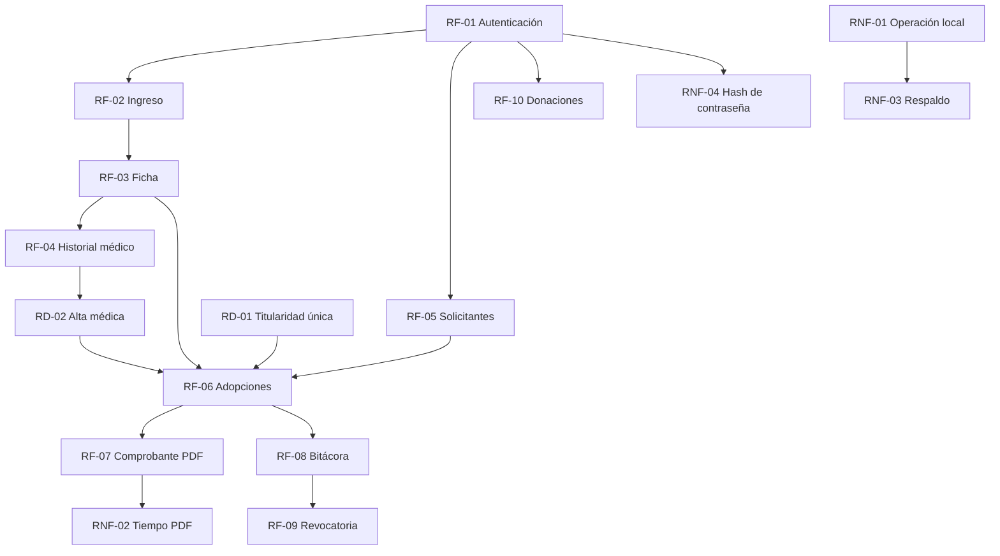

# Informe de Análisis y Refinamiento — SG-RAC

**Proyecto:** Sistema de Gestión para Refugio de Animales de Compañía (SG-RAC)
**Entregable:** 3 — Catálogo de Requerimientos y Análisis de Refinamiento
**Documento base:** `01_Catalogo_Requerimientos.md`

Este informe examina de forma crítica los requerimientos del catálogo. Detecta problemáticas, identifica dependencias, evalúa la viabilidad de los requerimientos críticos y presenta la versión refinada de los requerimientos afectados.

---

## 1. Problemáticas detectadas

Se detectaron **10 problemáticas**. Cada una indica el requerimiento afectado, su categoría, la justificación y la corrección aplicada.

| ID | Requerimiento | Problemática | Justificación | Corrección |
|---|---|---|---|---|
| P-01 | RF-05 (versión inicial) | **Ambigüedad** | La expresión "condiciones socioambientales" no define qué datos se registran. Dos desarrolladores podrían implementar formularios distintos. | Se enumeran los datos: tipo de vivienda, espacio disponible, número de convivientes y ocupación del solicitante. |
| P-02 | RF-06 / conflicto C-01 | **Incompletitud** | No contemplaba el control del plazo de la adopción temporal. Sin ese control, los plazos vencidos pasan inadvertidos. | Se incorpora una fecha límite obligatoria y una alerta en el panel del Administrador por plazos vencidos. |
| P-03 | RF-09 (versión inicial) / conflicto C-02 | **Subjetividad** | "Maltrato/incumplimiento" no tenía criterios objetivos. La decisión de retirar un animal quedaba sin respaldo formal. | La revocatoria exige un criterio objetivo registrado en la bitácora: evaluación médica desfavorable, reincidencia en incumplimiento de cuidados o indicios de maltrato. |
| P-04 | RF-06 / RD-02 | **Conflicto potencial entre requerimientos** | RF-06 permitía registrar una adopción definitiva sobre un animal en tratamiento crítico, lo cual RD-02 prohíbe. | Se precisa en RD-02 y RF-06 que, sin alta médica registrada, el sistema bloquea la adopción definitiva. |
| P-05 | RNF-03 (versión inicial) | **Incompletitud** | No indicaba quién inicia el respaldo ni cómo se confirma su resultado. | El respaldo lo inicia manualmente el Administrador hacia una unidad USB, y el sistema confirma la finalización o informa el error. |
| P-06 | RNF-04 (versión inicial) | **Inconsistencia técnica** | El catálogo hablaba de "cifrado y algoritmos de hashing". El cifrado es reversible y no es adecuado para contraseñas, y la frase mezcla dos mecanismos. | Se usa un único mecanismo: hash con sal mediante bcrypt, con factor de costo mínimo de 10. |
| P-07 | RNF-02 (versión inicial) | **No verificable** | "Menos de 3 segundos" no define el equipo de medición ni cuántas mediciones se toman. Sin ello, la prueba no es repetible. | Se fija una prueba de 10 generaciones consecutivas, todas en menos de 3 s, en el equipo de instalación. |
| P-08 | RF-04 | **Inconsistencia de fuente** | La fuente incluía al veterinario, pero el sistema es monousuario y solo el Administrador accede a él. El veterinario no puede ser quien registra los datos. | El Administrador registra los datos clínicos que entrega el veterinario. El veterinario permanece como fuente de información, no como usuario. |
| P-09 | RF-10 | **Inconsistencia entre documentos** | El catálogo listaba "juguetes" como categoría, pero la información I-08 define alimentos, dinero, medicinas, suministros y servicios veterinarios. | Se alinea RF-10 con I-08. Los juguetes pasan a la categoría "suministros". |
| P-10 | RF-11 (propuesto) | **Requerimiento innecesario** | Los reportes estadísticos no aportan valor en la primera versión y aumentan el esfuerzo. | Se reclasifica como "Could" y se pospone. |

## 2. Dependencias identificadas

### 2.1 Tabla de dependencias

| Requerimiento | Depende de | Motivo |
|---|---|---|
| RF-02, RF-03, RF-04, RF-05, RF-06, RF-07, RF-08, RF-09, RF-10 | RF-01 | Toda función requiere un Administrador autenticado. |
| RF-03 | RF-02 | La ficha se crea a partir del ingreso del animal. |
| RF-04 | RF-03 | El historial médico se asocia a la ficha del animal. |
| RF-06 | RF-03, RF-05, RD-01, RD-02 | Requiere un animal con ficha, un solicitante registrado, titularidad única y alta médica cuando la adopción es definitiva. |
| RD-02 | RF-04 | El alta médica se registra en el historial clínico. |
| RF-07 | RF-06 | El comprobante se genera a partir de una adopción registrada. |
| RF-08 | RF-06 | El seguimiento requiere una adopción vigente. |
| RF-09 | RF-06, RF-08 | El criterio objetivo se registra en la bitácora de una adopción vigente. |
| RNF-02 | RF-07 | El límite de tiempo se mide sobre la generación del PDF. |
| RNF-03 | RNF-01 | El respaldo parte de una base de datos local. |
| RNF-04 | RF-01 | La protección de la contraseña es parte de la autenticación. |

### 2.2 Diagrama de dependencias

Cada flecha indica "el origen debe existir antes que el destino". Las dependencias de RF-01 hacia RF-03, RF-04, RF-06, RF-07, RF-08 y RF-09 son transitivas y no se dibujan.

### 2.3 Observaciones sobre las dependencias

- **Ruta crítica:** RF-01 → RF-02 → RF-03 → RF-04 → RD-02 → RF-06 → RF-07. Un retraso en cualquiera de estos requerimientos retrasa el objetivo central del sistema, que es procesar adopciones.
- **Requerimiento con más dependencias:** RF-06 depende de cinco requerimientos distintos. Por eso se analiza su viabilidad en la sección 3.
- **Relación RF-07 y RNF-02:** el RF-07 está sujeto al límite de tiempo de RNF-02. La dependencia es de verificación, no de construcción: RF-07 se construye primero y RNF-02 se mide sobre él. No existe una dependencia circular.
- **RF-08 y RF-09 son independientes de las donaciones y del respaldo.** Pueden implementarse en una segunda iteración sin afectar el flujo principal.

## 3. Análisis de viabilidad

Se analizan tres requerimientos críticos. RF-06 es el más crítico del catálogo: es el objetivo central del sistema y el que más dependencias concentra.

### 3.1 RF-06 — Procesamiento de adopciones (requerimiento crítico principal)

| Dimensión | Evaluación | Justificación |
|---|---|---|
| **Técnica** | Viable | Requiere reglas de negocio simples (titularidad única, bloqueo sin alta médica, comparación de fechas para alertas) sobre una base de datos local. No necesita tecnologías externas. El mayor riesgo es la integridad de los datos entre animal, solicitante y adopción. |
| **Económica** | Viable | Se desarrolla con herramientas y bibliotecas de código abierto, sin licencias. El costo principal es el tiempo de desarrollo y pruebas. |
| **Temporal** | Viable con riesgo medio | Es el requerimiento de mayor esfuerzo junto con RF-04. Depende de RF-03, RF-05 y RF-04. Se debe planificar después de completar esos tres. |
| **Organizacional** | Viable | El Administrador ya ejecuta este proceso de forma manual. El sistema formaliza un flujo que conoce. Se requiere una capacitación breve sobre las modalidades y las alertas. |

**Conclusión:** viable. **Riesgo principal:** que las reglas RD-01 y RD-02 se implementen de forma incompleta. **Mitigación:** definir pruebas de regla de negocio antes de programar (ver criterios de aceptación del Entregable 4).

### 3.2 RF-07 — Comprobante PDF

| Dimensión | Evaluación | Justificación |
|---|---|---|
| **Técnica** | Viable | Existen bibliotecas de generación de PDF que funcionan sin conexión a Internet, lo que cumple RNF-01. |
| **Económica** | Viable | Se emplean bibliotecas de código abierto sin costo de licencia. |
| **Temporal** | Viable | Se puede construir en la primera iteración, una vez disponible RF-06. |
| **Organizacional** | Viable | El Administrador dispone de impresora y requiere una capacitación breve. |

### 3.3 RNF-03 — Respaldo local

| Dimensión | Evaluación | Justificación |
|---|---|---|
| **Técnica** | Viable | Se resuelve copiando el archivo de la base de datos hacia una unidad USB y verificando la copia. |
| **Económica** | Viable | Solo requiere una unidad de almacenamiento externa. |
| **Temporal** | Viable | Se puede construir en la primera iteración. |
| **Organizacional** | Viable con condición | El respaldo es manual. Su eficacia depende de que el Administrador lo ejecute con regularidad. Se recomienda definir una frecuencia, por ejemplo semanal, en el manual de uso. |

## 4. Versión refinada de los requerimientos afectados

Se muestra el texto inicial, el texto refinado y la problemática que motivó el cambio. Las fichas completas están en el Entregable 4.

| ID | Versión inicial | Versión refinada | Problemática |
|---|---|---|---|
| RF-04 | Registrar y actualizar el historial médico (vacunas, cirugías, desparasitaciones, recetas). Fuente: Veterinario / Admin. | El sistema deberá permitir al Administrador registrar y actualizar vacunas, desparasitaciones, cirugías, medicación activa, revisiones periódicas y alta médica en el historial de cada animal. Fuente: Administrador (con información de veterinarios). | P-08 |
| RF-05 | Registrar solicitantes de adopción con datos personales y condiciones socioambientales. | El sistema deberá permitir registrar al solicitante con cédula, domicilio, ocupación, tipo de vivienda, espacio disponible y número de convivientes. | P-01 |
| RF-06 | Procesar adopciones en modalidad temporal (con fecha fin) o definitiva, asignando titularidad. | El sistema deberá registrar una adopción temporal con fecha de inicio, fecha límite y plan de medicación. El sistema deberá registrar una adopción definitiva asignando al solicitante como único titular. El sistema deberá bloquear la adopción definitiva de un animal sin alta médica registrada. El sistema deberá mostrar una alerta en el panel del Administrador cuando venza el plazo de una adopción temporal. | P-02, P-04 |
| RF-09 | Permitir la revocatoria de custodia ante maltrato o incumplimiento y reintegrar al animal. | El sistema deberá permitir revocar la custodia únicamente cuando el Administrador registre un criterio objetivo: evaluación médica desfavorable, reincidencia en incumplimiento de cuidados o indicios de maltrato. El sistema deberá reintegrar al refugio al animal cuya custodia se revoca. | P-03 |
| RF-10 | Registrar donaciones clasificadas en alimento, dinero, medicamentos, juguetes y servicios. | El sistema deberá permitir registrar donaciones clasificadas en alimentos, dinero, medicamentos, suministros y servicios veterinarios, con fecha y donante. | P-09 |
| RNF-02 | Generar el PDF en menos de 3 segundos. | El sistema deberá generar el comprobante PDF de adopción en menos de tres segundos en el equipo de instalación. Verificación: diez generaciones consecutivas, todas por debajo de tres segundos. | P-07 |
| RNF-03 | Proveer función de respaldo local manual hacia USB. | El sistema deberá permitir al Administrador iniciar manualmente el respaldo de la base de datos hacia una unidad USB. El sistema deberá confirmar la finalización del respaldo o informar el error. | P-05 |
| RNF-04 | Almacenar credenciales mediante cifrado y algoritmos de hashing seguros. | El sistema deberá almacenar la contraseña del Administrador como hash con sal mediante bcrypt, con factor de costo mínimo de 10. | P-06 |
| RD-02 | Un animal en tratamiento crítico no podrá ser entregado en adopción definitiva sin alta médica. | Un animal en tratamiento médico crítico no deberá entregarse en adopción definitiva sin alta médica registrada. | P-04 |

## 5. Pendientes de validación

- Confirmar con el Administrador el cambio de categorías de RF-10 (P-09) y la fuente de RF-04 (P-08).
- Confirmar con Soporte TI el algoritmo bcrypt y la frecuencia recomendada de respaldo.
- La revisión de los interesados sobre RF-06, RF-09 y RNF-03 sigue pendiente, según la lista de verificación de validación del SRS.
